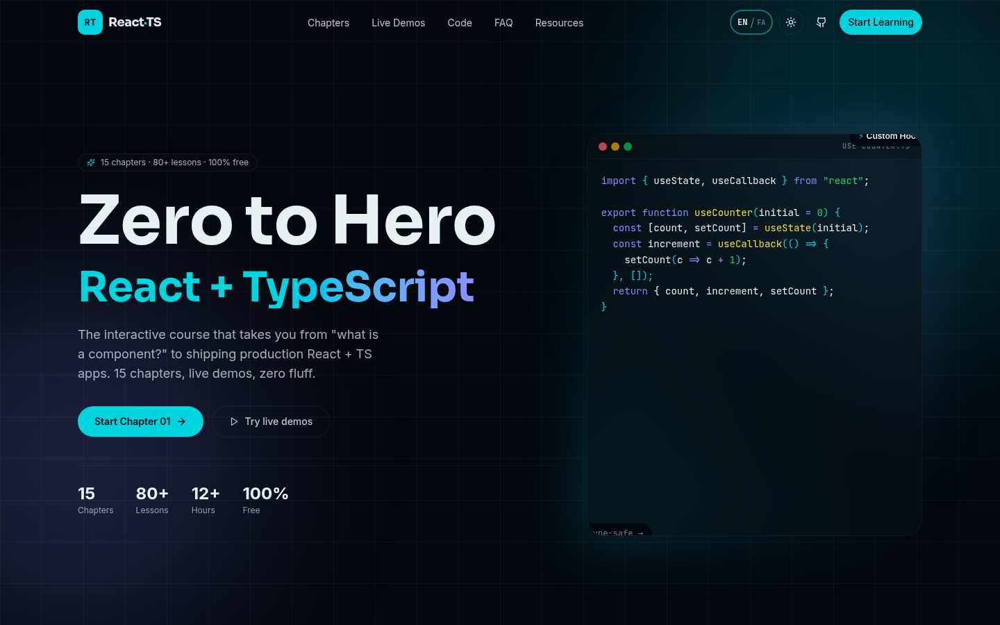
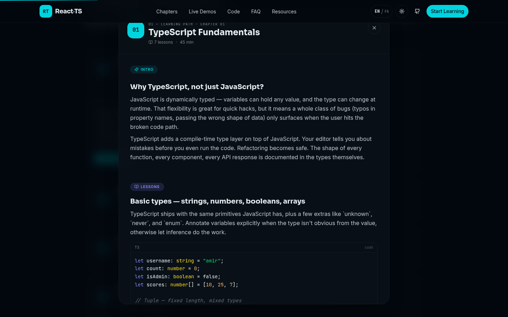
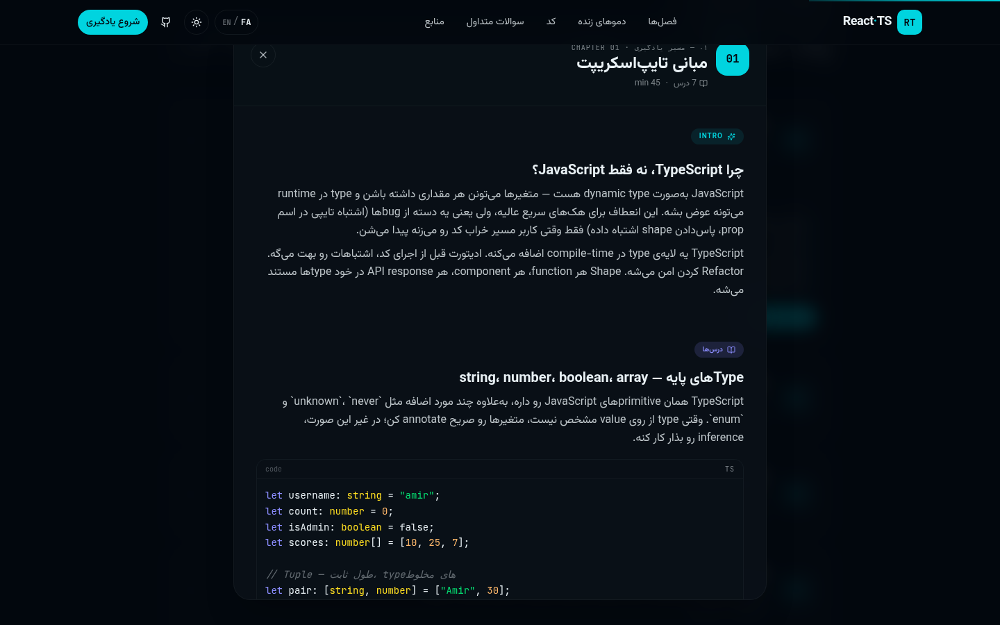

<div align="center">

# React · TypeScript Mastery

### Zero to Hero — interactive React + TypeScript course, bilingual EN/FA

[](https://amiralisite.github.io/react-ts-mastery/)
[](https://github.com/amiraliSite/react-ts-mastery)
[](https://opensource.org/licenses/MIT)
[](https://nextjs.org/)
[](https://www.typescriptlang.org/)
[](https://tailwindcss.com/)
[](https://www.framer.com/motion/)

**15 chapters · 80+ lessons · 4 live interactive demos · bilingual EN/FA · 100% free and open-source**

</div>

---

## 🎬 Live Demo Video

> 22-second walkthrough: hero → expand a chapter → open the chapter modal → switch to Persian live → close with Esc → explore demos.


<details>
<summary>🎥 Prefer higher-quality MP4? (310 KB)</summary>

[Download demo-v2.mp4](docs/demo-v2.mp4) — same content, smaller file, sharper text.

</details>

---

## ✦ About this project

A single-page, interactive tutorial site that takes you from "what is a React component?" to shipping production React + TypeScript apps. **Every chapter has full lesson content** — an intro section, three lessons with syntax-highlighted code examples, and a key-takeaways list. **Bilingual EN/FA with a language toggle** — click EN/FA and the entire UI (including chapter content) switches instantly, with RTL layout and Persian font.

> Built as a portfolio piece and learning resource. **MIT licensed**, free to fork, learn from, and ship from.

### Essential features

- 📚 **15 chapters with full lesson content** — every chapter has an intro + 3 lessons + key takeaways, each with syntax-highlighted code examples
- 🪟 **Chapter modal** — slides up from the bottom (mobile) or centered (desktop), with sticky header, scrollable body, Esc-to-close, body-scroll lock
- 🌍 **Bilingual EN/FA** — one click in the navbar switches the entire UI: text, chapter content, layout direction (LTR↔RTL), and fonts (Inter→Vazirmatn, Sora→Vazirmatn). Language is persisted in `localStorage`.
- 🎮 **4 live interactive demos** — Counter, Todo List, Async Fetch, Reducer+Theme — running real React + TypeScript in your browser
- 💾 **Progress tracking** — mark chapters as done; progress is persisted to `localStorage` and shown in a circular progress widget
- 🎨 **Premium dark theme** — deep navy with electric cyan + cosmic violet accents; light mode toggle included
- 🔤 **Custom syntax highlighter** — hand-rolled token highlighter in <100 lines for code examples (no `prismjs` dependency)
- 📱 **Fully responsive** — mobile drawer, tablet, and desktop layouts
- ⚡ **Static-export ready** — env-aware `next.config.ts` switches between dev standalone and GitHub Pages export
- 🆓 **No login, no tracking, no paywall** — pure static HTML/CSS/JS once built

---

## ✦ What it looks like

### English mode — hero


### Persian mode — hero (RTL, Vazirmatn font)



### Chapter modal — full lesson content (English)



The modal opens when you click "Start chapter" on any chapter card. Inside: intro section, 3 lessons each with a paragraph + syntax-highlighted code example, and key takeaways. Scrollable, sticky header, Esc to close.

### Chapter modal — Persian (live switch)



Switch language while the modal is open — content translates instantly, layout flips to RTL, font swaps to Vazirmatn. No reload.

---

## ✦ Tech stack

| Layer | Choice | Why |
|------|--------|-----|
| Framework | **Next.js 16** (App Router, Turbopack) | Latest, supports static export to GitHub Pages out of the box |
| Language | **TypeScript 5** strict | The whole point of the course — practice what we preach |
| Styling | **Tailwind CSS 4** | Utility-first, fast iteration, RTL-aware with logical properties |
| Motion | **Framer Motion 12** | Best-in-class React animation library |
| i18n | Custom Context + dictionary | Zero-dependency, perfectly typed, no library bloat |
| Theme | **next-themes** | Dark/light with no flash-of-incorrect-theme |
| Icons | **lucide-react** | Tree-shakeable, consistent, beautiful |
| UI kit | **shadcn/ui** (Button only) | Just what we need, no over-import |
| Fonts | **Sora** + **Inter** + **JetBrains Mono** (EN) · **Vazirmatn** (FA) | All via `next/font` — zero layout shift |
| Storage | **localStorage** | Progress + language persistence without a backend |

---

## ✦ Project structure

```
src/
├─ app/
│  ├─ layout.tsx          # fonts, metadata, ThemeProvider + LanguageProvider
│  ├─ page.tsx            # composes all sections
│  └─ globals.css         # navy + cyan/violet theme, RTL-aware font switching
├─ components/
│  ├─ site/               # all course-specific sections
│  │  ├─ navbar.tsx              # with EN/FA toggle
│  │  ├─ hero.tsx
│  │  ├─ marquee.tsx
│  │  ├─ learning-path.tsx       # 15 chapters + "Start chapter" → opens modal
│  │  ├─ chapter-modal.tsx       # full lesson content viewer (NEW)
│  │  ├─ demos-container.tsx     # tabbed demo container
│  │  ├─ demos/
│  │  │  ├─ counter-demo.tsx
│  │  │  ├─ todo-demo.tsx
│  │  │  ├─ fetch-demo.tsx
│  │  │  └─ context-demo.tsx
│  │  ├─ code-showcase.tsx       # custom syntax highlighter
│  │  ├─ faq.tsx
│  │  ├─ resources.tsx
│  │  ├─ cta.tsx
│  │  ├─ footer.tsx
│  │  ├─ language-provider.tsx  # Context + localStorage + RTL dir/lang sync
│  │  ├─ language-toggle.tsx   # EN/FA button in navbar
│  │  ├─ theme-provider.tsx
│  │  ├─ theme-toggle.tsx
│  │  └─ scroll-progress.tsx
│  └─ ui/                 # shadcn/ui components
└─ lib/
   ├─ curriculum.ts       # 15 chapters + resources + FAQ + stats (with faTitle/faBlurb)
   ├─ chapter-content.ts  # full lesson content for all 15 chapters (NEW)
   ├─ i18n.ts             # 130+ translation keys (EN + FA)
   └─ utils.ts
```

---

## ✦ The 15 chapters

Each chapter has the same shape in `chapter-content.ts`: intro → 3 lessons (each with code) → key takeaways. All bilingual.

| # | Chapter | Difficulty |
|---|---------|------------|
| 01 | TypeScript Fundamentals | Beginner |
| 02 | React + TS Project Setup | Beginner |
| 03 | Components & Props | Beginner |
| 04 | State & Events | Beginner |
| 05 | Effects & Lifecycles | Intermediate |
| 06 | Refs & DOM | Intermediate |
| 07 | Context & Reducer | Intermediate |
| 08 | Custom Hooks | Intermediate |
| 09 | Performance Patterns | Advanced |
| 10 | Forms & Validation | Intermediate |
| 11 | Routing (App Router) | Advanced |
| 12 | Data Fetching | Advanced |
| 13 | State Management | Advanced |
| 14 | Testing | Advanced |
| 15 | Deployment & Patterns | Advanced |

---

## ✦ Getting started

### Run locally

```bash
git clone https://github.com/amiraliSite/react-ts-mastery.git
cd react-ts-mastery
bun install         # or npm install / pnpm install
bun run dev         # → http://localhost:3000
```

### Build for GitHub Pages

The `next.config.ts` is env-aware — when `GH_PAGES=true`, it produces a static export with `basePath: /react-ts-mastery`.

```bash
GH_PAGES=true bun run build
# → outputs to out/
```

If you fork and rename the repo, update `basePath` and `assetPrefix` in `next.config.ts` to match your repo name.

---

## ✦ Customize

- **Add/edit chapters**: edit `src/lib/curriculum.ts` (metadata) and `src/lib/chapter-content.ts` (lesson content). Both have a `fa` variant for Persian.
- **Add/edit UI strings**: edit `src/lib/i18n.ts` — add to the `en` and `fa` objects, then use `t("your.key")` in components.
- **Add a new language**: add to the `Lang` type in `i18n.ts`, add a new object in `translations`, add a font in `layout.tsx`, add a CSS rule for `body.lang-{code}` in `globals.css`.

---

## ✦ Credits

- **Built by**: [amiraliSite](https://github.com/amiraliSite)
- **Stack**: Next.js 16 · TypeScript 5 · Tailwind CSS 4 · Framer Motion 12
- **License**: MIT — fork it, learn from it, ship from it.

## ✦ Links

- 🌐 **Live site**: https://amiralisite.github.io/react-ts-mastery/
- 📦 **Source**: https://github.com/amiraliSite/react-ts-mastery
- 💬 **Issues / feedback**: https://github.com/amiraliSite/react-ts-mastery/issues

---

<div align="center">

If this project helped you learn React + TypeScript, give it a ⭐ on GitHub.

</div>
